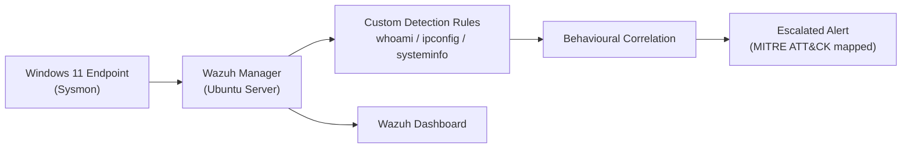

 

---

## About Me

Entry-level SOC Analyst and Computer Science graduate with lab and project experience in **alert triage**, **threat detection** and **incident response** using **Splunk**, **Elastic Stack** and **Wazuh**.

I build my own detection labs, write custom detection rules, and map attacker behaviour to **MITRE ATT&CK**. I'm looking for an entry-level **SOC Analyst (Tier 1)** role.

---

## Featured Projects

### Home SOC Lab: Wazuh Detection Engineering

A home SOC built to practise the full detection workflow, from endpoint telemetry to an escalated alert.

- Deployed **Wazuh Manager and Dashboard** on **Ubuntu Server**, monitoring a **Windows 11** endpoint through **Sysmon**.
- Wrote **custom Wazuh detection rules** for attacker discovery commands: `whoami.exe`, `ipconfig.exe` and `systeminfo.exe`.
- Implemented **behavioural correlation** that escalates multiple discovery detections into one higher-severity alert.
- Mapped detections to the **MITRE ATT&CK** framework.

 

### Final Year Project: Regex-Based Web Application Firewall

A Web Application Firewall that detects and blocks common web attacks from the OWASP Top 10.

- Designed and developed a **regex-based Web Application Firewall** that detects and blocks **SQL Injection (SQLi)** and **Cross-Site Scripting (XSS)** attacks.
- Implemented **request filtering** and **regex signature-based intrusion detection**.
- Analysed malicious web traffic and wrote **custom rules** to prevent exploitation attempts.

---

## Hands-On Training

| Platform | What I did |
| :-- | :-- |
| **TryHackMe** | Completed all **65 hands-on labs** (14 modules, 65+ hours) of the **SOC Level 1** path with Splunk, Elastic Stack and Sysmon |
| **LetsDefend** | Investigated and triaged simulated security alerts across Windows and Linux environments |

**Focus areas:** phishing analysis, malware analysis, suspicious network traffic, threat hunting with IOCs, and incident reporting with containment and remediation recommendations.

---

## Tech Stack

**SIEM and Monitoring**

**Threat Detection and Response**

**Frameworks and Security**

**Platforms**

---

## Education and Certifications

- 🎓 **BS Computer Science**, Govt. College University Faisalabad, Sahiwal Campus (2022 to 2026), CGPA 3.04 / 4.00
- 📜 **Ethical Hacker Course**, Cisco Networking Academy (2026)
- 📜 **Cyber Security Certificate**, Asian Development Bank Institute (ADBI) (2026)
- 🛡️ **SOC Level 1 Learning Path**, TryHackMe (2026)

---

## Let's Connect

I'm open to **entry-level SOC Analyst** roles, onsite, hybrid or remote.

 

*"Defence is a habit, built one investigation at a time."*

